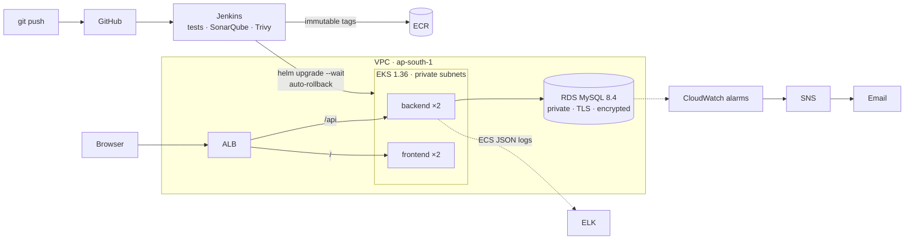

# Production-Grade Microservices Platform with Zero-Downtime Deployment

**Order & Inventory Management System** — a React + Spring Boot + MySQL application delivered through a
production-style DevOps workflow: automated tests and quality gates, container and dependency scanning,
immutable images, Terraform-provisioned AWS infrastructure, Helm deployments to EKS with verified
zero-downtime rollouts and automatic rollback, Ansible-configured Jenkins, CloudWatch/SNS alerting and
ELK logging.

> **Status (2026-10-19): deployed and verified on AWS (ap-south-1).** Jenkins on EC2 (configured by Ansible)
> ran the full pipeline — tests, SonarQube quality gate, Trivy gates, ECR push, Helm deploy to EKS, health checks
> through the ALB (build #4; build #7 from GitHub). Through the public ALB: 20/20 read/write smoke checks against RDS; 9,532 requests
> with **0 errors** during two releases, a bad-image release, an unhealthy release (both auto-rolled back) and a
> restart. Alerts proven CloudWatch → SNS → SQS; logs searchable in ELK on EKS. Evidence and the remaining
> open items: [docs/TESTING.md](docs/TESTING.md), deployment record: [docs/AWS_DEPLOYMENT.md](docs/AWS_DEPLOYMENT.md).
>
> **Evaluation mode:** between demos the environment is suspended (no nodes, no ALB, Jenkins/RDS stopped,
> ≈ $4/day; nothing deleted). Restore + verify with one command, `bash scripts/resume-evaluation.sh`
> (≈ 10 min, prints the application URL — the ALB hostname changes on every resume); suspend again with
> `bash scripts/suspend-evaluation.sh`. See [docs/RUNBOOKS.md §10](docs/RUNBOOKS.md#10-suspend--resume-for-evaluation-keep-everything-pay-4day).

---

## 1. The problem and the workflows

A small business needs to manage a product catalogue with live stock levels, register customers, take
multi-item orders that reserve stock, and move orders through `PENDING → CONFIRMED → SHIPPED → DELIVERED`
or `CANCELLED` (which returns stock). Engineering requirements: never oversell stock under concurrent
orders, ship changes without downtime, detect bad releases and roll back automatically, and keep secrets
and costs under control.

| Workflow | Where |
|---|---|
| Dashboard: KPIs, recent orders, low-stock alerts | `/dashboard` |
| Products: create/edit/delete, stock status (in / low / out of stock) | `/products` |
| Users: register customers (unique, case-insensitive email) | `/users` |
| Orders: multi-line orders with live total, status changes, cancellation restores stock | `/orders` |

API reference with real request/response examples: [docs/API.md](docs/API.md).

## 2. Architecture



More diagrams (CI/CD flow, data model, environments) and design decisions: [docs/ARCHITECTURE.md](docs/ARCHITECTURE.md).

## 3. Technology stack — and why

| Layer | Technology | Why |
|---|---|---|
| Frontend | React 18, React Router 7, Vite 8, nginx 1.30 (unprivileged) | SPA served as static files; nginx adds the `/api` reverse proxy and security headers |
| Backend | Java 17, Spring Boot 4.1, Spring Data JPA (Hibernate 7), Bean Validation | Mature REST stack; transactions + row locks for stock |
| Database | MySQL 8.4 (Compose / RDS), Flyway migrations | Versioned, reproducible schema; Hibernate only validates |
| Containers | Multi-stage Dockerfiles, Docker Compose | Reproducible builds; non-root runtime images |
| IaC | Terraform | VPC, EKS, RDS, ECR, KMS, S3, IAM, CloudWatch, Budgets as code |
| Config management | Ansible | Idempotent Jenkins host setup with pinned toolchain |
| Orchestration | Amazon EKS, Helm, AWS Load Balancer Controller | Rolling updates, probes, PDBs; ALB ingress |
| CI/CD | Jenkins (declarative pipeline, configuration as code for local CI) | Tests → quality gate → scans → build → deploy → verify → rollback |
| Quality / security | SonarQube, Trivy (images, deps, IaC, secrets), gitleaks | Gates that fail the build |
| Monitoring | CloudWatch alarms + SNS, AWS Budgets | AWS-native, low cost, email alerts |
| Logging | ELK (Filebeat → Elasticsearch → Kibana) | Structured ECS logs, request-id correlation, dashboard |
| Storage | S3 | Per-build CI reports (encrypted, 30-day expiry) |

## 4. Repository structure

```text
.
├── order-inventory-platform/      # the application
│   ├── backend/                   #   Spring Boot API, Flyway migrations, 29 tests, Dockerfile
│   ├── frontend/                  #   React app, nginx config, 21 tests, ESLint, Dockerfile
│   ├── logging/                   #   Filebeat, ILM retention, Kibana saved objects
│   ├── docker-compose.yml         #   MySQL + backend + frontend
│   ├── docker-compose.logging.yml #   optional ELK overlay
│   └── .env.example
├── helm/order-inventory/          # Helm chart (values.yaml = EKS, values-minikube.yaml = local)
├── k8s/                           # namespace, LB-controller IAM policy, local test DB fixture
├── terraform/                     # AWS infrastructure (+ environments/full|learning.tfvars)
├── ansible/                       # Jenkins host configuration + container test
├── ci/                            # reproducible Jenkins image + local Jenkins/SonarQube
├── aws/iam/                       # scoped IAM policy for the deployer identity
├── scripts/                       # deploy, smoke/acceptance tests, bootstrap helpers
├── docs/                          # architecture, API, runbooks, security, testing, checklist, evidence
├── Jenkinsfile
└── CONTRIBUTING.md
```

## 5. Prerequisites

| Tool | Version used | Needed for |
|---|---|---|
| Docker Desktop (Compose v2) | 29.x | everything local |
| Git for Windows (Git Bash) | 2.5x | running the `scripts/*.sh` helpers |
| Java JDK + Maven | 17+ / 3.9 | backend outside Docker |
| Node.js | ≥ 20.19 (24 LTS used) | frontend outside Docker |
| minikube + kubectl + Helm | 1.38 / 1.34+ / 4.x | local Kubernetes |
| Terraform, AWS CLI v2 | 1.10+ / 2.x | AWS |

## 6. Quick start (PowerShell)

```powershell
git clone https://github.com/SamruddhiDoke/DevOps-Project.git
cd DevOps-Project\order-inventory-platform
Copy-Item .env.example .env        # optional: change passwords/ports
docker compose up -d --build       # first start creates the schema (Flyway) and demo data
docker compose ps                  # mysql, backend, frontend -> healthy
Start-Process http://localhost:3000
Invoke-RestMethod http://localhost:3000/api/health/ready   # status UP, database UP
```

Stop with `docker compose stop` or `docker compose down` — both keep the data volume. **Do not** use
`down -v` unless you want to delete the database.

Ports already in use? Set `FRONTEND_HOST_PORT`, `BACKEND_HOST_PORT`, `MYSQL_HOST_PORT` in `.env`.

### Environment variables

| Variable | Used by | Default (local) | Purpose |
|---|---|---|---|
| `MYSQL_ROOT_PASSWORD`, `DB_USER`, `DB_PASSWORD` | Compose `.env` | placeholders in `.env.example` | Local MySQL accounts (app uses the non-root `DB_USER`) |
| `SPRING_DATASOURCE_URL` / `_USERNAME` / `_PASSWORD` | backend | Compose MySQL | Database connection (EKS: from Secret `mysql-secret`) |
| `SPRING_FLYWAY_LOCATIONS` | backend | `classpath:db/migration` (+`db/seed` in Compose) | Schema migrations; demo data only for an empty local DB |
| `APP_ENVIRONMENT` | backend | `local` | Added to every structured log line |
| `LOGGING_STRUCTURED_FORMAT_CONSOLE` | backend | unset (text) | `ecs` = JSON logs (set on EKS and in the ELK overlay) |
| `CORS_ALLOWED_ORIGINS` | backend | `*` | Only needed if the UI is served from another origin |
| `BACKEND_URL` | frontend nginx | `http://backend:8080` | `/api` proxy target |
| `VITE_API_BASE_URL` / `VITE_DEV_API_PROXY` | frontend build / dev server | `/api` / `http://localhost:8080` | API location |
| `TF_VAR_alert_email` | Terraform | empty | Optional email for alarms/budget (alerts always reach the SQS audit queue) |
| `admin_cidr_blocks` | `terraform/admin.auto.tfvars` (git-ignored) | — | Your IP/32 for Jenkins SSH/UI and the EKS API |

### Database schema and initialization

Flyway owns the schema (`backend/src/main/resources/db/migration`): `V1` tables and foreign keys, `V2`
indexes and `CHECK` constraints (non-negative stock, positive price/quantity). Hibernate runs with
`ddl-auto=validate`. Databases created before Flyway are **baselined** (existing data untouched). The local
demo seed (`db/seed/R__demo_data.sql`) inserts data only when the `users` table is empty.

## 7. Testing — commands and actual results

```powershell
cd order-inventory-platform\backend;  mvn -B clean verify          # 29 tests, JaCoCo report
cd ..\frontend; npm ci; npm run lint; npm run test:coverage; npm run build   # 21 tests
```

Bash (Git Bash/WSL), from the repository root:

```bash
./scripts/smoke-test.sh http://localhost:3000                       # 20 end-to-end API/UI checks
COMPOSE_PROJECT_NAME=oi-check ./scripts/compose-acceptance-test.sh  # 8 checks on an isolated volume
./scripts/k8s-acceptance-test.sh                                    # 10 checks on minikube
./ansible/test/test-in-container.sh                                 # lint + apply + idempotency
./ci/start-local-ci.sh                                              # local Jenkins + SonarQube
```

| Suite | Result (2026-10-18) |
|---|---|
| Backend unit/integration/concurrency/failure-path | **29/29 passed**; line coverage 71 %, branch 75 % (JaCoCo) |
| Frontend unit/component/workflow | **21/21 passed**; line coverage 80 %; ESLint 0 problems; production build OK |
| Docker Compose acceptance (fresh volume) | **8/8**: health, 20-check smoke test, persistence, DB outage → 503 → recovery, crash auto-restart |
| Kubernetes acceptance (minikube, Helm) | **10/10**: 0 failed of 5,757 requests across a rolling update and two failed releases with automatic rollback; DB outage removes pods from service with 0 restarts |
| Jenkins pipeline (local controller, `DEPLOY=false`) | **SUCCESS**: tests, SonarQube quality gate passed (backend + frontend), Trivy gates, Helm lint, image builds |
| Ansible (Ubuntu 24.04 + systemd container) | ansible-lint production profile clean; apply OK; **second run changed=0** |
| Terraform | fmt/validate OK; plan 77 (full) / 62 (learning) to add, 0 change/destroy; Trivy IaC scan clean (documented exceptions) |
| Container images (Trivy) | see [docs/TESTING.md](docs/TESTING.md#security-scans) |

Full methodology, evidence files and the list of AWS-only checks still to run: [docs/TESTING.md](docs/TESTING.md).

## 8. CI/CD pipeline (Jenkinsfile)

Checkout (immutable tag `<build>-<commit>`) → Environment check → Backend tests + coverage → Frontend
lint/tests/build → **SonarQube quality gate** → **Trivy** dependency (CRITICAL), IaC (HIGH/CRITICAL) and
secret scans → Helm lint → Docker build → **Trivy image gate** (fixable HIGH/CRITICAL) → push to ECR →
Helm deploy with `--wait` (automatic rollback on failure) → verify image tags → in-cluster readiness +
public ALB smoke test → summary. Reports are archived and uploaded to S3. A post-deploy failure rolls back
to the previously recorded Helm revision. `DEPLOY=false` runs the CI half only (used for the local run).

Run it locally: `./ci/start-local-ci.sh`, open http://localhost:18090 (user `admin`, password in the
git-ignored `ci/.env`), job `order-inventory` → *Build with Parameters*.

## 9. Kubernetes and Helm

```bash
# Local (minikube)
minikube start
for s in backend frontend; do docker build -t local/order-inventory-$s:v1 order-inventory-platform/$s; done
minikube image load local/order-inventory-backend:v1 local/order-inventory-frontend:v1
kubectl apply -f k8s/namespace.yaml
# create the DB secret (see scripts/k8s-acceptance-test.sh for a disposable test database)
./scripts/deploy-k8s.sh local v1 -f helm/order-inventory/values-minikube.yaml
```

**Zero-downtime design:** `maxUnavailable: 0` / `maxSurge: 1`, readiness on `/api/health/ready`,
liveness/startup on `/api/health` (no DB dependency → no restart loops during DB outages), 10 s `preStop`
drain, Spring graceful shutdown, ALB deregistration delay 20 s, PodDisruptionBudgets.

**How it was verified:** an in-cluster client requested `/api/products` through the frontend every 50 ms
during each release and counted every non-200 response (0 failures). This proves the Kubernetes-level
behaviour; ALB deregistration timing can only be verified on EKS.

**Rollback:** automatic in `scripts/deploy-k8s.sh` (Helm rollback to the last good revision) and in the
Jenkins `post { failure }` block; manual: `helm -n order-inventory rollback order-inventory <revision>`.

## 10. AWS infrastructure (Terraform)

What is created (77 resources, `environments/full.tfvars`): VPC (2 public + 2 private subnets, ALB tags),
IGW, one NAT gateway, EKS 1.36 + managed node group, OIDC/IRSA roles (EBS CSI, LB controller), KMS key
(EKS Secrets + SNS), RDS MySQL 8.4 (private, encrypted, TLS-only, 7-day backups, log exports), ECR
(immutable tags, scan on push, keep 20), Jenkins EC2 (admin CIDR only, IMDSv2, least-privilege IAM),
S3 report bucket, CloudWatch alarms → SNS, AWS Budget. `learning.tfvars` drops Jenkins EC2 and uses one node.

Provisioning, cluster bootstrap, Ansible, deployment and teardown: [docs/RUNBOOKS.md](docs/RUNBOOKS.md).

### Cost (ap-south-1 on-demand prices from the AWS Pricing API, 2026-10-18)

| Component | Unit price | Full | Learning |
|---|---|---|---|
| EKS control plane | $0.10/h (extended-support versions: $0.50/h) | $73.00 | $73.00 |
| t3.medium EKS nodes | $0.0448/h | 2 × $32.70 = $65.41 | 1 × $32.70 |
| t3.large Jenkins + SonarQube | $0.0896/h | $65.41 | — (local Jenkins) |
| NAT gateway | $0.056/h + $0.056/GB | $40.88 + data | $40.88 + data |
| ALB | $0.0239/h + $0.008/LCU-h | ≈ $20 | ≈ $20 |
| RDS db.t3.micro + 20 GB gp3 | $0.025/h + $0.131/GB-mo | $20.87 | $20.87 |
| EBS gp3 (node 20 GB, Jenkins 30 GB) | $0.0912/GB-mo | $6.38 | $1.82 |
| Public IPv4 (NAT, ALB ×2, Jenkins) | $0.005/h each | $14.60 | $10.95 |
| KMS, alarms, logs, ECR, S3 | — | ≈ $3 | ≈ $3 |
| Secrets Manager (3), extra alarms | $0.40/secret, $0.10/alarm | ≈ $2.40 | ≈ $1.60 |
| **Total** | | **≈ $311/month ≈ $0.43/h** | **≈ $204/month ≈ $0.28/h** |

A 4-hour demo costs about **$1.20–$1.80**. EKS, NAT and the ALB dominate; **suspend (≈ $4/day, `scripts/suspend-evaluation.sh`) or destroy after use**
(teardown order in the runbook — delete the Ingress before `terraform destroy`). An AWS Budget with email
alerts is created when `alert_email` is set.

## 11. Ansible

`ansible/playbooks/jenkins.yml` configures the Jenkins EC2 host: base packages, unattended security
upgrades, validated SSH hardening, Docker, the pinned toolchain (same versions as the CI image) and Jenkins
LTS. Copy `inventory.example.ini` to `inventory.ini` with `terraform output jenkins_public_ip`, then
`ansible-playbook playbooks/jenkins.yml --check` and without `--check`.

## 12. Monitoring and logging

- **CloudWatch + SNS** (`terraform/monitoring.tf`): RDS CPU / free storage / memory / connections, Jenkins
  status check and CPU, EKS node CPU, NAT port allocation; ALB 5xx and unhealthy-target alarms via
  `scripts/create-alb-alarms.sh`; AWS Budget at 80 % actual / 100 % forecast.
- **ELK** (`docker-compose.logging.yml`): Filebeat ships app containers only; backend logs are ECS JSON with
  `requestId`, `service.environment`, level and logger; 7-day ILM retention; `logging/kibana-setup.sh`
  imports the *Order Inventory – Operations* dashboard. Tracing a failed order by its `requestId`:
  [docs/RUNBOOKS.md §6](docs/RUNBOOKS.md#6-trace-a-failed-order-logs).

## 13. Security

Summary: no secrets in the repository (state, `.env`, keys, inventories ignored; Trivy + gitleaks secret
scans), non-root hardened containers, KMS-encrypted Kubernetes Secrets, private TLS-only encrypted RDS,
admin-CIDR-only Jenkins and EKS API, least-privilege IAM, immutable images, quality and vulnerability gates.
A previously exposed (now destroyed) RDS password exists in old public history — remediation and
rotation procedures: [docs/SECURITY.md](docs/SECURITY.md).

## 14. Troubleshooting

| Symptom | Likely cause / fix |
|---|---|
| Backend container restarting, `FlywayMigrateException` | A migration failed; see the log line, fix the SQL, run `flyway repair` ([runbook §7](docs/RUNBOOKS.md#7-database-operations)) |
| UI shows "Unexpected response from API" | `/api` is not routed to the backend (nginx `BACKEND_URL` / Ingress rule) |
| API returns 503 "database is temporarily unavailable" | MySQL/RDS unreachable; pods recover automatically when it returns |
| Backend pods 0/1 Ready, no restarts | Same as above (readiness gating by design) |
| `docker compose up`: port already allocated | Set the `*_HOST_PORT` values in `.env` |
| Ingress has no address on EKS | Load Balancer Controller not installed/healthy, or subnet tags missing |
| `terraform destroy` fails on VPC/subnets | ALB still exists — delete the Ingress first (runbook §8) |
| Jenkins: `dubious ownership` / cannot clone | Local CI only: rebuild the image (`ci/start-local-ci.sh`) |

## 15. Known limitations and work not yet verified

- **Jenkins builds from a Git mirror on the Jenkins host**, not GitHub, until the rewritten (secret-free) history
  is force-pushed to GitHub — that push awaits the repository owner's approval. The GitHub-triggered flow is
  therefore not yet verified.
- HTTP only (no domain/ACM certificate); demo login page without authentication.
- The backend uses the RDS master user; a dedicated least-privilege DB user is recommended.
- Single NAT gateway (not AZ-redundant) to limit cost; SonarQube runs on the Jenkins host (single instance, no HA).
- ELK on EKS is demo-sized (single-node Elasticsearch on an emptyDir; logs are lost if that pod is rescheduled).
- Screenshots are not included; evidence is provided as command output in `docs/evidence/`.

## Further documentation

[Architecture](docs/ARCHITECTURE.md) · [API](docs/API.md) · [Runbooks](docs/RUNBOOKS.md) ·
[Security](docs/SECURITY.md) · [Testing report](docs/TESTING.md) · [Operational checklist](docs/OPERATIONS_CHECKLIST.md) ·
[Contributing](CONTRIBUTING.md)
