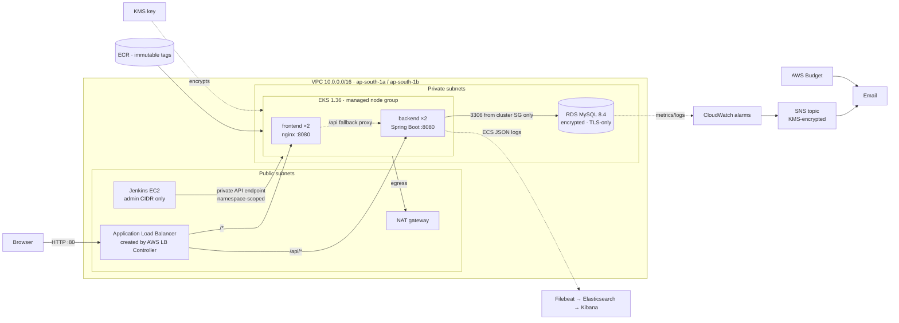
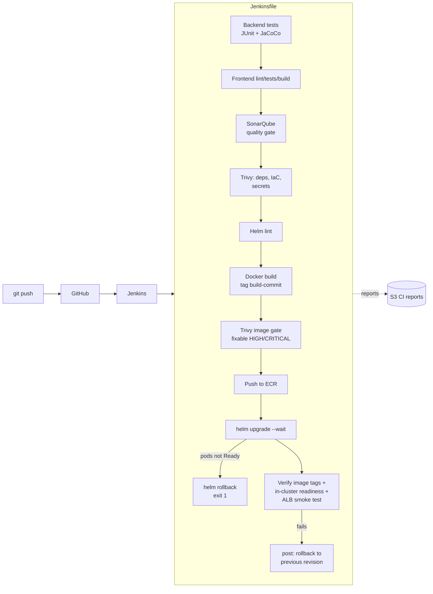
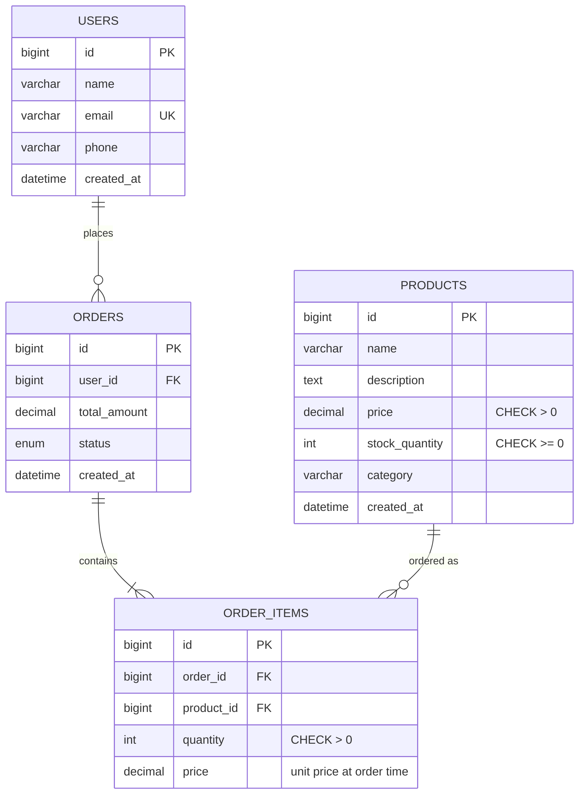

# Architecture

Diagrams are Mermaid (rendered by GitHub; edit them as text).

## 1. Runtime on AWS

Key decisions:
- **Same-origin API.** The browser always calls `/api`. The ALB routes `/api` to the backend; nginx in the
  frontend also proxies `/api`, so Docker Compose, port-forwarding and EKS use one frontend build.
- **Liveness vs readiness.** `/api/health` (no DB) drives liveness and ALB health; `/api/health/ready`
  (DB check) drives readiness. A database outage removes pods from traffic without restart loops.
- **Zero-downtime rollouts.** `maxUnavailable: 0`, readiness gating, 10 s `preStop` drain, graceful
  Spring shutdown, 20 s ALB deregistration delay, PDBs.
- **Schema ownership.** Flyway migrations own the schema; Hibernate validates it.

## 2. CI/CD

## 3. Data model

Order rules: creating an order locks the product rows (`SELECT … FOR UPDATE`, ascending id order) and
reserves stock atomically; cancelling restores stock exactly once; cancelled orders are final; products
referenced by orders cannot be deleted (409).

## 4. Environments

| Concern | Local (Compose) | Local Kubernetes (minikube) | AWS |
|---|---|---|---|
| Database | MySQL 8.4 container + named volume | MySQL fixture on a PVC | RDS MySQL 8.4 |
| Ingress | nginx on :3000 | `kubectl port-forward` | ALB |
| Images | built locally | `minikube image load` | ECR |
| Deploy | `docker compose up` | `scripts/deploy-k8s.sh local <tag> -f values-minikube.yaml` | Jenkins → `scripts/deploy-k8s.sh` |
| Logs | ELK overlay | `kubectl logs` (ECS JSON) | ECS JSON on stdout; ship with Filebeat |
| Alerts | — | — | CloudWatch → SNS, AWS Budget |
