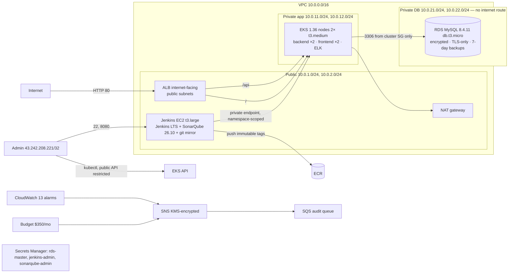

# AWS deployment record (ap-south-1)

Deployed 2026-10-18/19 with the `order-inventory-deployer` IAM user (scoped policy in
`aws/iam/`), never the root key. Every item below was checked against AWS/Kubernetes, not only
Terraform output. Evidence: [`evidence/`](evidence/).

## Application endpoint

**http://k8s-orderinv-orderinv-00335110a2-2009364498.ap-south-1.elb.amazonaws.com** (HTTP only; the
hostname is assigned by the AWS Load Balancer Controller and changes if the Ingress is recreated —
get it with `kubectl -n order-inventory get ingress order-inventory-ingress`).

Deployed release: images `order-inventory-{backend,frontend}:4-bf7450d` (Jenkins build #4, commit
`bf7450d`), Helm release `order-inventory` (revision 7 after the rollback tests).

## Architecture as deployed



## Resource inventory

| Group | Resources (key identifiers) | Billable while idle |
|---|---|---|
| Network | VPC `vpc-06635e7967e5c59ca`, 6 subnets (2 public, 2 app, 2 DB), IGW, NAT gateway + EIP `3.111.24.35`, 3 route tables | **NAT gateway, EIP** |
| EKS | cluster `order-inventory-eks` 1.36 (KMS secrets encryption), managed node group 2× t3.medium, add-ons vpc-cni/coredns/kube-proxy/ebs-csi, OIDC provider | **control plane, 2 nodes + EBS** |
| Load balancing | ALB + 2 target groups (created by the AWS LB Controller v3.6.0, IRSA role `order-inventory-aws-lbc-role`) | **ALB, 2 public IPv4** |
| Database | RDS `order-inventory-mysql` (8.4.11, db.t3.micro, 20 GB gp3, private DB subnets, parameter group `require_secure_transport=1`), log groups (14-day retention) | **instance + storage** |
| CI/CD | Jenkins EC2 `i-03288b455e674765e` t3.large (IMDSv2, 30 GB encrypted gp3), IAM role/instance profile, EKS access entry (namespace `order-inventory`, edit) | **instance, EBS, public IPv4** |
| Registry | ECR `order-inventory-backend`, `order-inventory-frontend` (immutable, scan on push, keep 20) — the unrelated `frontend` repository is untouched | storage (~150 MB) |
| Secrets/keys | Secrets Manager ×3, KMS key `alias/order-inventory-app` | $0.40/secret, $1/key |
| Monitoring | 9 Terraform alarms + 4 ALB alarms (script), SNS topic, SQS audit queue + subscription, AWS Budget | alarms $0.10 each |
| Storage | S3 CI reports bucket (30-day expiry), S3 Terraform state bucket (bootstrap stack) | negligible |
| Terraform | 102 resources in remote state `s3://order-inventory-tfstate-038215676861` (+5 bootstrap) | — |

### Monthly cost (on-demand, AWS Pricing API prices for ap-south-1)

EKS $73.00 · 2× t3.medium $65.41 · t3.large $65.41 · NAT $40.88 + $0.056/GB · ALB ≈ $20 · RDS ≈ $20.87 ·
public IPv4 (NAT EIP, ALB ×2, Jenkins) $14.60 · EBS $6.38 · Secrets Manager $1.20 · KMS $1 ·
13 alarms $1.30 · ECR/S3/logs < $1 → **≈ $311/month ≈ $0.43/hour.** Everything except ECR/S3 storage
bills while idle. The Budget alerts at 80 % of $350 (actual) and 100 % (forecast).

## How it was verified

| Check | Result |
|---|---|
| `terraform apply` | 90 + 6 resources created, 0 changed/destroyed; later `terraform plan` → no changes |
| EKS | ACTIVE 1.36; public API limited to the admin /32; nodes Ready in private subnets; add-ons ACTIVE |
| RDS | available, private (resolves to 10.0.22.34, port 3306 unreachable from the internet), encrypted, TLS-only, SG allows only the EKS cluster SG |
| Jenkins host (Ansible) | first run 49 ok / 24 changed / 0 failed; repeat runs `changed=0`; Jenkins active + enabled, `/login` 200 after restart; SonarQube UP on 127.0.0.1 only; secrets files `root:jenkins 0640` |
| Jenkins pipeline | build #4 **SUCCESS** from the rewritten history (commit `bf7450d`): 29 backend tests, SonarQube quality gate PASSED (backend + frontend), Trivy gates, ECR push, Helm deploy, 8 health checks through the ALB |
| ECR | `4-bf7450d` backend `sha256:…` and frontend digests recorded in the build; ECR basic scan: 0 findings; Trivy: 0 HIGH/CRITICAL |
| Database migrations | Flyway applied V1 and V2 on RDS (two replicas, lock-coordinated; no baseline marker) |
| Public application | full 20-check read/write smoke test through the ALB passed; ALB target groups healthy |
| Zero downtime / rollback | 9,532 requests through the ALB during 2 releases, a bad image, an unhealthy release and a restart: **0 non-200**; both failed releases detected (exit 1) and rolled back ([evidence](evidence/aws-zero-downtime-2026-10-19.txt)) |
| Alert delivery | `set-alarm-state` on `order-inventory-rds-cpu-high` → SNS (KMS) → SQS message received with the expected alarm/state/metric; alarm restored to OK |
| Budget | configured: $350, ACTUAL 80 % and FORECASTED 100 % → SNS (threshold not reached, so not triggered) |
| ELK | ES/Kibana/Filebeat Ready, read-only root filesystems; failed order found by `requestId` with Kubernetes metadata; 7-day ILM; DB password in 0 documents ([evidence](evidence/elk-eks-2026-10-19.txt)) |

## Source of truth for Jenkins

GitHub `origin/main` still carries the pre-remediation history (rewrite awaiting approval). Jenkins
therefore checks out a bare mirror on the Jenkins host, `/srv/git/devops-project.git`, updated with:

```bash
GIT_SSH_COMMAND="ssh -i ~/Downloads/UniversalKey.pem -o IdentitiesOnly=yes" git push jenkins-mirror main
```

The job polls the mirror every 5 minutes. After the GitHub history is replaced, re-run
`JENKINS_REPO_URL=https://github.com/SamruddhiDoke/DevOps-Project.git ./ansible/run-playbook.sh` to switch
the job to GitHub (polling; a webhook additionally requires GitHub's hook IP ranges in `admin_cidr_blocks`).

## Teardown (stops all charges)

```bash
export AWS_PROFILE=order-inventory AWS_REGION=ap-south-1
kubectl delete -f k8s/logging/elk.yaml                                  # optional; removed with the nodes anyway
kubectl -n order-inventory delete ingress order-inventory-ingress       # deletes the ALB, its TGs and SGs
until [ "$(aws elbv2 describe-load-balancers --query "length(LoadBalancers[?starts_with(LoadBalancerName,'k8s-orderinv')])")" = 0 ]; do sleep 10; done
helm uninstall aws-load-balancer-controller -n kube-system
aws cloudwatch describe-alarms --alarm-name-prefix order-inventory-alb --query 'MetricAlarms[].AlarmName' --output text | xargs -r aws cloudwatch delete-alarms --alarm-names
cd terraform
terraform plan -destroy -var-file=environments/full.tfvars -var-file=admin.auto.tfvars    # review
terraform destroy -var-file=environments/full.tfvars -var-file=admin.auto.tfvars
```

Then run the post-teardown checklist in [RUNBOOKS.md §8](RUNBOOKS.md#8-teardown-order-matters-and-verification).
Secrets Manager secrets and the KMS key enter a 7-day recovery/pending-deletion window. The state bucket
(bootstrap stack) is kept for a later re-deploy; delete it with `terraform -chdir=terraform/bootstrap destroy`
after emptying its versions if you no longer need the state.
