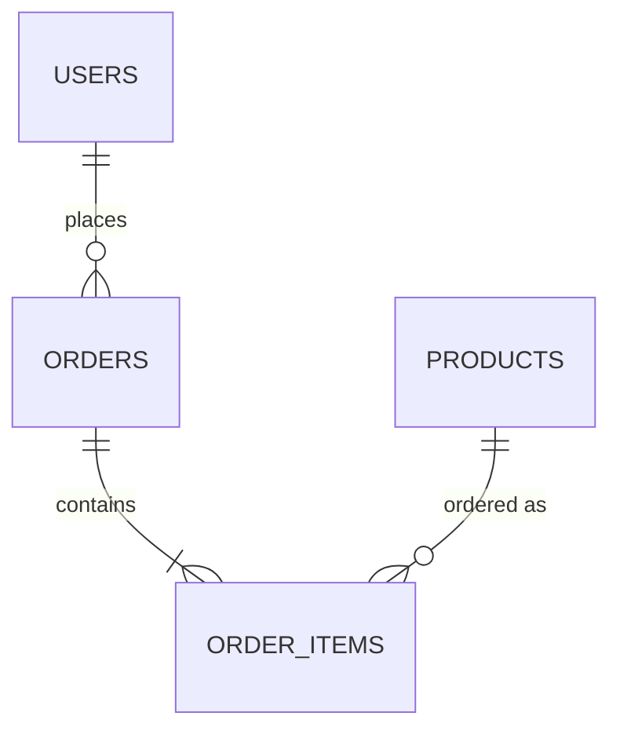

# Part 7 — MySQL, RDS and Flyway

[← Handbook](../COMPLETE_PROJECT_HANDBOOK_AND_VIVA_GUIDE.md)

## 4.1 Schema and relationships

Database `order_inventory_db` (MySQL 8.4). Defined only by Flyway migrations in
`order-inventory-platform/backend/src/main/resources/db/migration/`.



### `V1__initial_schema.sql` (line by line)

```sql
CREATE TABLE users (
    id         BIGINT       NOT NULL AUTO_INCREMENT,   -- surrogate primary key generated by MySQL
    name       VARCHAR(100) NOT NULL,
    email      VARCHAR(100) NOT NULL,
    phone      VARCHAR(20),                            -- optional
    created_at DATETIME(6)  NOT NULL,                  -- microsecond precision (matches Java LocalDateTime)
    PRIMARY KEY (id),
    CONSTRAINT uk_users_email UNIQUE (email)           -- one account per email (index + constraint)
);
```

```sql
CREATE TABLE products (
    id BIGINT NOT NULL AUTO_INCREMENT, name VARCHAR(150) NOT NULL, description TEXT,
    price DECIMAL(10,2) NOT NULL,                      -- exact money, up to 99,999,999.99
    stock_quantity INT NOT NULL, category VARCHAR(50), created_at DATETIME(6) NOT NULL,
    PRIMARY KEY (id));
```

```sql
CREATE TABLE orders (
    id BIGINT NOT NULL AUTO_INCREMENT, user_id BIGINT NOT NULL, total_amount DECIMAL(10,2) NOT NULL,
    status ENUM('CANCELLED','CONFIRMED','DELIVERED','PENDING','SHIPPED') NOT NULL,   -- only valid values
    created_at DATETIME(6) NOT NULL, PRIMARY KEY (id),
    CONSTRAINT fk_orders_user FOREIGN KEY (user_id) REFERENCES users (id));      -- order must belong to an existing user
```

```sql
CREATE TABLE order_items (
    id BIGINT NOT NULL AUTO_INCREMENT, order_id BIGINT NOT NULL, product_id BIGINT NOT NULL,
    quantity INT NOT NULL, price DECIMAL(10,2) NOT NULL,                          -- unit price at order time
    PRIMARY KEY (id),
    CONSTRAINT fk_order_items_order   FOREIGN KEY (order_id)   REFERENCES orders (id),
    CONSTRAINT fk_order_items_product FOREIGN KEY (product_id) REFERENCES products (id));
```

- Foreign keys have **no `ON DELETE CASCADE`**: deleting a product used by an order is refused by the
  database → the API returns 409. History is never silently deleted.
- *In general*, InnoDB creates an index for each foreign key automatically, so joins on `user_id`,
  `order_id`, `product_id` are indexed.
- The comment at the top explains the baseline behaviour (§4.3).

### `V2__indexes_and_integrity_checks.sql`

```sql
CREATE INDEX idx_orders_status     ON orders (status);        -- filter by status
CREATE INDEX idx_orders_created_at ON orders (created_at);    -- "newest first" listing
CREATE INDEX idx_products_category ON products (category);    -- category filters
ALTER TABLE products    ADD CONSTRAINT chk_products_stock_non_negative CHECK (stock_quantity >= 0);
ALTER TABLE products    ADD CONSTRAINT chk_products_price_positive     CHECK (price > 0);
ALTER TABLE order_items ADD CONSTRAINT chk_order_items_quantity        CHECK (quantity > 0);
```
`CHECK` constraints (enforced by MySQL ≥ 8.0.16) are a **second line of defence** for invariants that the API
already validates: even a bug or a manual SQL statement cannot create negative stock. Adding them in V2
(not editing V1) is the correct Flyway practice: V1 had already been applied to existing databases.

### `db/seed/R__demo_data.sql`

A **repeatable** migration (prefix `R__`: re-applied when its checksum changes, after all versioned ones).

```sql
SET @seed_demo_data = (SELECT COUNT(*) = 0 FROM users);
INSERT INTO users (…) SELECT * FROM ( SELECT 1 AS id, 'Alex Morgan' AS name, … UNION ALL SELECT 2, … ) AS seed WHERE @seed_demo_data;
```
Inserts 5 users, 8 products, 5 orders and 7 order items **only if `users` is empty**, so it can never
overwrite real data. Aliases on the first `SELECT` avoid MySQL's "duplicate column name" error in derived
tables. It is only active where `classpath:db/seed` is added to `SPRING_FLYWAY_LOCATIONS` (Docker Compose);
**never on AWS**, so the RDS database contains only data created through the API (including smoke-test
records with names like `smoke-<epoch>-<random>`).

## 4.2 How Flyway works here

1. Spring Boot starts, creates the DataSource, then runs Flyway **before** Hibernate and before the web server.
2. Flyway takes a lock (*in general*, MySQL uses a named lock) so that two pods starting at the same time do
   not migrate concurrently — observed on RDS: "two replicas, lock-coordinated" (`docs/AWS_DEPLOYMENT.md`).
3. It reads `flyway_schema_history` (creates it on first run), compares applied versions/checksums with the
   files `V1__…`, `V2__…` (ordered by version number), and applies only missing ones in order, each recorded
   with checksum, time and success flag.
4. A changed checksum of an applied migration makes validation fail at startup — protecting against edited
   history. Rule (`database/README.md`, `CONTRIBUTING.md`): never edit an applied migration; add `V3__…`.
5. Hibernate then validates the entities (`ddl-auto=validate`).

Observed on RDS after resume (2026-10-19 log): "Successfully validated 2 migrations", "Current version of
schema `order_inventory_db`: 2", "Schema `order_inventory_db` is up to date. No migration necessary."

**Why migrations are version-controlled:** the schema changes together with the code that needs it, is
reviewed in the same commit, and is applied identically in tests (H2), Compose, minikube and RDS. Rollback
consideration: a new migration must stay backward compatible for one release, because a Helm rollback runs
the previous application version against the newer schema.

## 4.3 Baselining

`spring.flyway.baseline-on-migrate=true`, `baseline-version=1`: if a database already contains tables but no
`flyway_schema_history` (databases created before Flyway was adopted), Flyway records version 1 as
"baseline" without running V1, then applies V2+. Verified on a real pre-existing local MySQL volume
(rows unchanged, V2 applied — `docs/TESTING.md`). On RDS the database was empty, so V1 and V2 ran normally
("no baseline marker").

## 4.4 How the application gets its database configuration

| Environment | Source |
|---|---|
| Tests | `application-test.properties` (H2 in memory) |
| Docker Compose | env in `docker-compose.yml`: `SPRING_DATASOURCE_URL=jdbc:mysql://mysql:3306/order_inventory_db?useSSL=false…`, user/password from `.env` or local defaults |
| EKS | Kubernetes Secret `mysql-secret` (keys `url`, `username`, `password`) → env vars `SPRING_DATASOURCE_*` in `helm/order-inventory/templates/backend.yaml` |

The Secret is created by `scripts/create-db-secret.sh`, which reads the Secrets Manager secret
`order-inventory/rds-master` (JSON with `username`, `password`, `host`, `port`, `dbname`, written by Terraform)
and pipes it into `kubectl create secret … --dry-run=client -o yaml | kubectl apply -f -` without printing it.
The URL is `jdbc:mysql://<rds-host>:3306/order_inventory_db?sslMode=REQUIRED&serverTimezone=UTC`.
`sslMode=REQUIRED` = the driver refuses unencrypted connections. On EKS the Secret is envelope-encrypted with
the project KMS key.

## 4.5 RDS networking and security (from `terraform/main.tf`)

| Setting | Value | Effect |
|---|---|---|
| Subnets | `aws_db_subnet_group.mysql` = the two **database subnets** 10.0.21.0/24, 10.0.22.0/24 | separate tier |
| Route table | `aws_route_table.database` has **no routes** besides the implicit local VPC route | no path to or from the internet (not even via NAT) |
| `publicly_accessible` | `false` | no public IP / public DNS resolution |
| Security group | `aws_security_group.rds` with one ingress rule: TCP 3306 **from the EKS cluster security group** | only pods/nodes of the cluster can connect; Jenkins and the internet cannot |
| Encryption at rest | `storage_encrypted = true` | data files, backups, snapshots encrypted (AWS-managed RDS key) |
| Encryption in transit | parameter `require_secure_transport = 1` + client `sslMode=REQUIRED` | plaintext connections rejected (verified: TLS cipher in use, `docs/TESTING.md`) |
| Engine | MySQL 8.4 (LTS; 8.0 would incur extended-support charges), db.t3.micro, gp3 20 GB autoscaling to 50 GB | |
| Memory tuning | `innodb_buffer_pool_size = {DBInstanceClassMemory*3/8}`, `performance_schema = 0` | fixed swapping on the 1 GiB instance (found by the FreeableMemory alarm; verified live) |
| Slow-query log | `slow_query_log = 1`, `long_query_time = 2`; exported with the error log to CloudWatch Logs (14-day retention) | diagnosis |
| Backups | `backup_retention_period = 7` (full profile), window 19:00–19:30 UTC; `copy_tags_to_snapshot` | daily snapshot + **point-in-time recovery** to any second within 7 days |
| Maintenance | Sunday 20:00–21:00 UTC; `auto_minor_version_upgrade = true` | |
| Lab settings | `skip_final_snapshot = true`, `deletion_protection = false` | allow a clean `terraform destroy` — which is exactly why destroy must not be used for routine suspension |

Measured: RDS private address 10.0.22.34; port 3306 unreachable from the internet; RDS reboot caused ~1 s of
503s with no pod restarts (`docs/evidence/aws-rds-interruption-2026-10-19.txt`).

## 4.6 Connection handling during restarts

HikariCP keeps up to 10 connections per pod. When RDS restarts: existing connections break → the next query
on them fails → Hikari discards them and opens new ones; requests that cannot get a connection within 5 s get
**503**; readiness fails → pods are removed from the Service/ALB until a connection succeeds; liveness stays 200
→ no restarts. When RDS is back, readiness passes and traffic resumes automatically.

## 4.7 Stopping RDS

`aws rds stop-db-instance` stops the **compute**; storage (gp3 volume), automated backups and the PITR window
are kept and still billed (storage), compute is not. *General AWS rule:* a stopped instance is started
automatically after **7 days**; the suspend script records this date (`rdsAutoRestartAfter`). While stopped,
no new automated backups are taken. The resume script starts it and waits for `available` (≈ 3–4 minutes
measured), then verifies the schema through Flyway's log lines and real reads/writes (smoke test).

How to verify the schema is intact (read-only, after resume):

```bash
kubectl -n order-inventory logs deploy/backend | grep -i flyway        # "up to date", version 2
curl -s $URL/api/products | head -c 300                                 # existing rows returned
```

Point-in-time restore (*general procedure*, not executed in this project): `aws rds
restore-db-instance-to-point-in-time --source-db-instance-identifier order-inventory-mysql
--target-db-instance-identifier <new-name> --restore-time <UTC time>` creates a **new** instance; the
application would then be pointed at it via the Secret. Status: IMPLEMENTED (backups enabled, PITR window
confirmed by the suspend script: "point-in-time recovery available up to …") BUT the restore itself NOT VERIFIED.

## 4.8 Four different kinds of "state" (do not mix them up)

| State | Where | Contains | Lost if … | Protected by |
|---|---|---|---|---|
| Terraform state | S3 `order-inventory-tfstate-038215676861/order-inventory/terraform.tfstate` | Terraform's record of which AWS resources it manages, their IDs and attributes (including the generated RDS password) | bucket deleted | versioning, encryption, TLS-only policy, native lock file |
| Application data | RDS `order_inventory_db` | users, products, orders | instance deleted without snapshot | 7-day backups/PITR, private network, encryption |
| Database backups | RDS automated snapshots + transaction logs (AWS-managed storage) | restorable copies | backup retention reduced/instance deleted (automated backups are deleted with the instance by default) | retention 7 days |
| Kubernetes state | EKS control plane (etcd, managed by AWS) | Deployments, Services, Ingress, Secrets, Helm release history (stored as Secrets) | cluster deleted | AWS-managed; Helm history allows rollback |

Example: `terraform destroy` reads the Terraform state and deletes the RDS instance → application data and
automated backups are gone (no final snapshot in this lab configuration). Scaling the node group to 0 changes
neither the Terraform state (desired size is ignored), the database, nor the Kubernetes objects.

## 4.9 Viva questions

| Question | Answer |
|---|---|
| Why Flyway? | Versioned, repeatable, reviewed schema changes applied automatically and identically everywhere; Hibernate only validates. |
| Why is RDS private? | It holds all business data; only the application needs it. Isolated subnets without internet routes + an SG that trusts only the EKS cluster SG + no public accessibility. |
| Is stopping RDS deleting data? | No — compute stops, storage and backups remain; AWS auto-starts after 7 days. |
| How would you add a column? | New file `V3__add_x.sql`, backward compatible (nullable/default), update entity + DTO, run `mvn verify` (tests apply all migrations and validate). |
| Why `DATETIME(6)`? | Matches Java `LocalDateTime` precision; Hibernate validation expects it. |
| What protects against negative stock? | Row locks in the service and the `CHECK (stock_quantity >= 0)` constraint. |
| What is the difference between Terraform state and AWS state? | Terraform state is Terraform's last known record; AWS is the truth. `terraform plan` refreshes and compares; differences are drift (e.g. a stopped Jenkins without public IP). |
