# Part 16 — Architecture diagrams and request flows

[← Handbook](../COMPLETE_PROJECT_HANDBOOK_AND_VIVA_GUIDE.md)

Diagrams are Mermaid (editable text; rendered by GitHub and by VS Code Mermaid preview extensions). Every box
corresponds to a real resource or file in this repository.

## 1. High-level system architecture

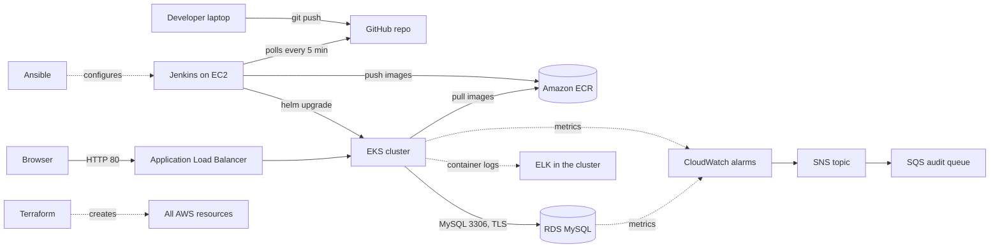

Plain English: developers push to GitHub; Jenkins notices, tests and packages the app, stores images in ECR and
deploys them to EKS. Users reach the app through the ALB. The app stores data in RDS. CloudWatch watches the
infrastructure and notifies through SNS; ELK keeps searchable logs. Terraform built the AWS side; Ansible
configured Jenkins. Files: `Jenkinsfile`, `terraform/*.tf`, `ansible/`, `helm/order-inventory/`.

## 2. AWS VPC and network layout

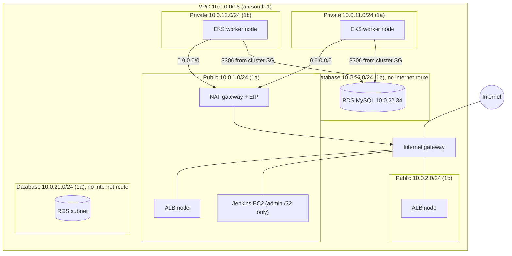

Route tables (`terraform/main.tf`): public → IGW; private → NAT; database → local only. Security groups:
ALB SG (controller-managed, port 80), cluster SG (nodes/pods), RDS SG (3306 from cluster SG), Jenkins SG (22
and 8080 from the admin /32), control-plane SG (443 from Jenkins).

## 3. Application request flow (EKS)

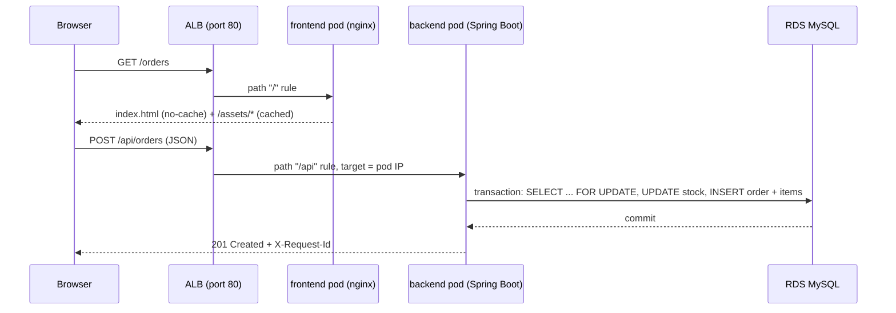

Files: `helm/order-inventory/templates/ingress.yaml`, `frontend/nginx/default.conf.template`,
`OrderController.java`, `OrderService.java`.

## 4. Database interaction (create order)

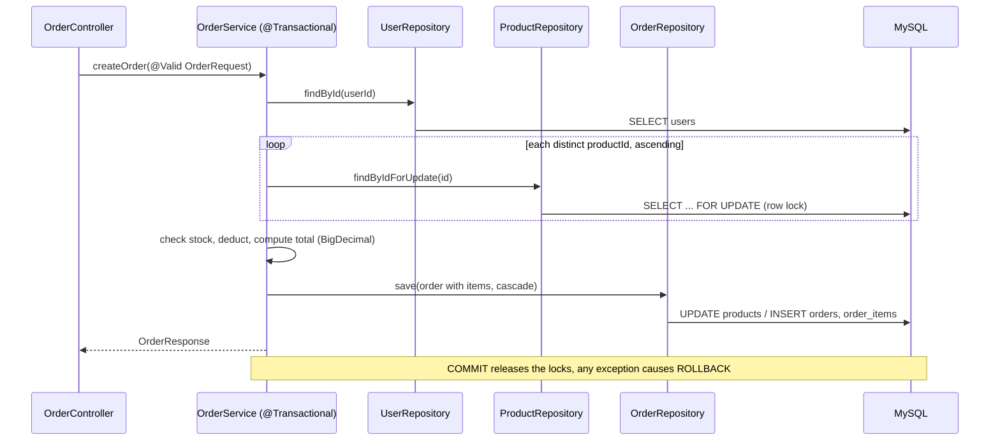

## 5. GitHub-to-Jenkins CI/CD pipeline

```mermaid
flowchart LR
    push["git push main"] --> poll["SCM poll H/5"]
    poll --> co["Checkout, tag = build-commit"]
    co --> env["Environment check"]
    env --> bt["Backend tests + JaCoCo"]
    bt --> fb["Frontend lint, tests, build"]
    fb --> sq{"SonarQube quality gate"}
    sq -->|pass| tv{"Trivy deps, IaC, secrets"}
    tv -->|pass| hl["Helm lint + template"]
    hl --> db["Docker build x2"]
    db --> ti{"Trivy image gate"}
    ti -->|pass| id["AWS identity + cluster ACTIVE"]
    id --> ecr["Push to ECR"]
    ecr --> kc["kubeconfig + can-i"]
    kc --> dep{"deploy-k8s.sh: helm upgrade --wait"}
    dep -->|"pods Ready"| ver["Verify image tags"]
    dep -->|"not Ready"| rb1["helm rollback, exit 1"]
    ver --> hc{"Readiness + ALB smoke test"}
    hc -->|pass| ok["SUCCESS + summary"]
    hc -->|fail| rb2["post: rollback to previous revision"]
    sq -->|fail| stop["Build FAILED"]
    tv -->|fail| stop
    ti -->|fail| stop
```

## 6. Docker image build and ECR publishing

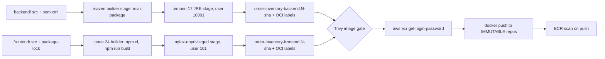

## 7. Helm deployment to EKS and ALB traffic

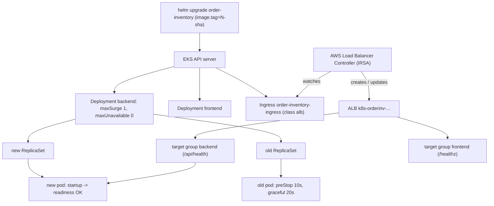

## 8. CloudWatch → SNS / SQS notification flow

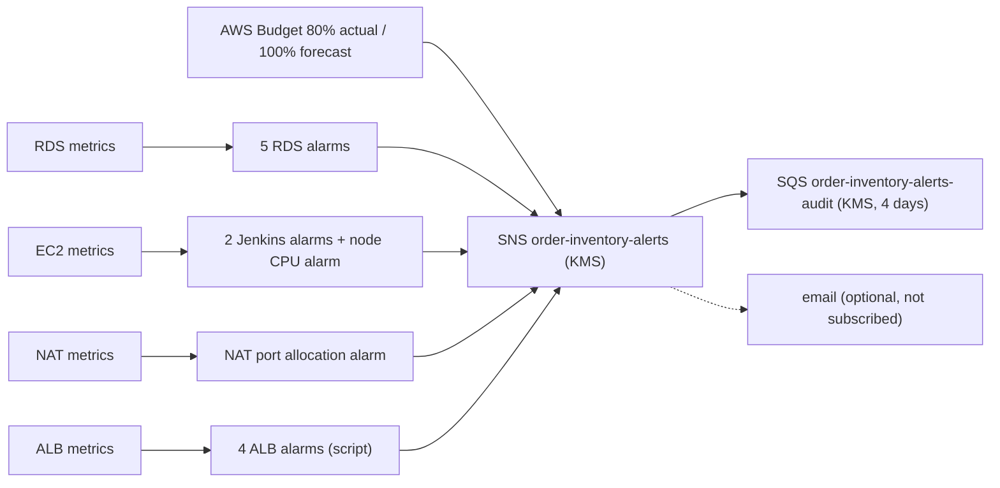

## 9. ELK logging flow

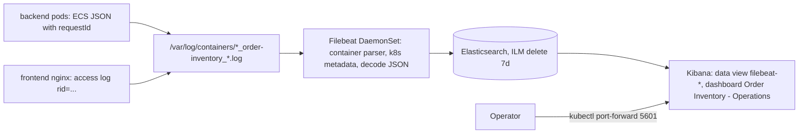

## 10. Terraform provisioning flow

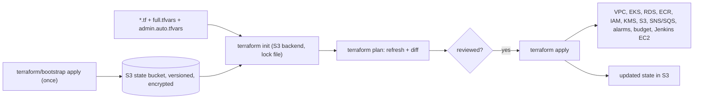

## 11. Ansible configuration of Jenkins

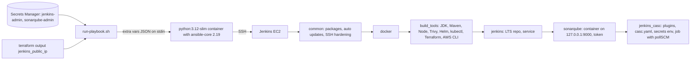

## 12. Suspension and restoration sequence

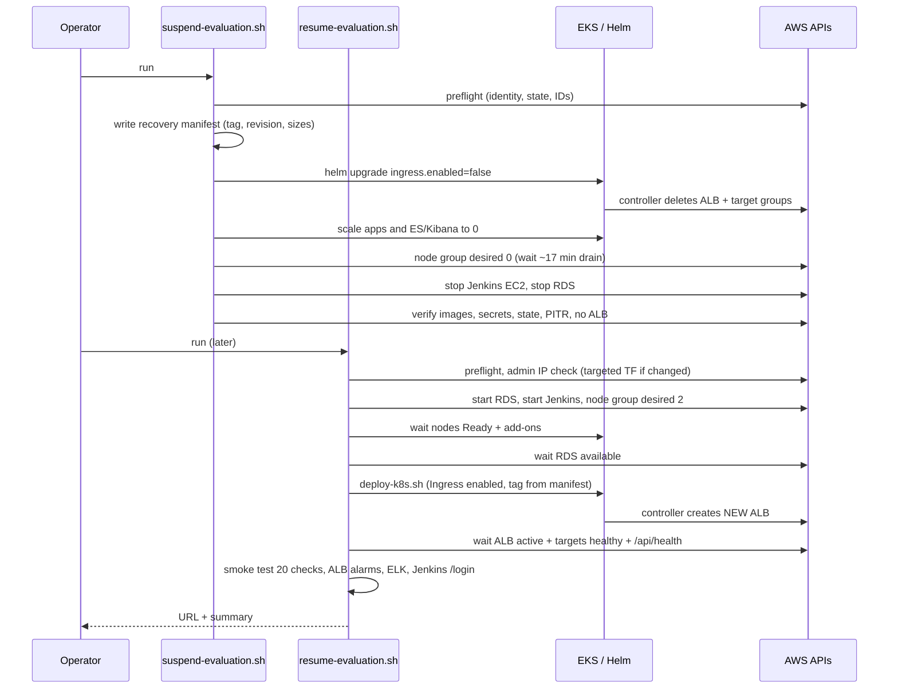
